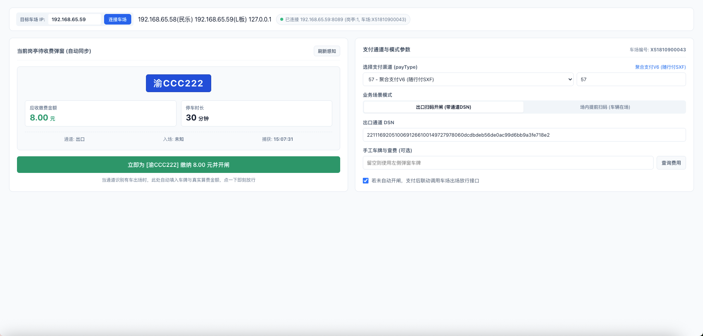

# drzk-pay-sim (道尔车场支付模拟与弹窗感知台)

道尔云 5.0 智慧停车系统的轻量化本地电子支付模拟与岗亭弹窗感知工具。
采用纯 Rust 开发，单文件二进制（约 800KB），无需安装 Python 或任何复杂依赖，开箱即用。



---

## 核心特性

- **双栏极简现代控制台**：无花哨图标，纯净高效的工程师级 UI。
- **岗亭收费弹窗感知雷达**：
  - 挂载在车场 WebSocket 通道上，当通道相机识别或岗亭弹出收费框时，自动抓取并呈现车牌、通道、应缴金额（分转元）；
  - 提供「立即代缴开闸放行」按钮，一键全自动下发支付并联动开闸。
- **动态多车场 IP 切换**：
  - 支持随时输入任意车场 IP 并一键连接；
  - 自动探测目标车场的唯一车场编号（`PARK_NUM`，如民乐村 `H51810900057`、L板 `X51810900043`）与在线岗亭操作员，避免跨车场错发；
  - 探测失败会直接报错并拒绝下发支付，**不会回退到任何写死的车场编号或 MQTT 地址**，杜绝"看起来正常、实际发错车场"。
- **可配置的远程探测凭据（界面可视化配置）**：
  - 车场编号、支付 MQTT 凭证、岗亭与通道信息，均由工具通过 SSH 登录车场服务器、在其本机执行 MySQL 查询实时获得；
  - 顶部导航提供「**SSH**」「**数据库**」两个按钮，直接在界面上改账号密码，保存即落盘、并自动用新凭据重连车场；
  - 密码不回显（只显示"已设置"），配置文件默认 `~/.drzk-pay-sim.json`、权限 0600；
- **全量支付渠道支持**：
  - 内置系统完整数据字典：微信直连(1)、支付宝直连(2)、随行付聚合V6(57)、ETC支付(21)、银联闪付(3)、无感支付(101/102)等；
  - 支持自由输入任意自定义数字编码。
- **场内预缴两步式流程（先查费、后预缴）**：
  - 手工输入车牌先查询在场费用，只有查费成功、拿到真实金额后，「模拟场内预缴」按钮才会解锁；
  - 预缴金额唯一取自后台实时算费，不可手工填写；改车牌或切换车场会立即作废上一次查费结果，避免用旧金额错缴；
  - 预缴只生成线上流水，不触发开闸，车辆仍留在场内。
- **内置原生轻量 MQTT 3.1.1 客户端**：
  - 纯标准 TCP 实现，无需 C 动态库，毫秒级直连云端 EMQX Broker 下发支付报文。
- **HTTP REST API 接口支持**：
  - 提供 `/api/pay`、`/api/popup/current`、`/api/server/switch`、`/api/fee/current` 等接口，方便与自动化脚本、CI/CD 或第三方平台集成。

---

## 快速使用

### 1. Web 界面模式 (默认)
直接运行程序，后台会自动启动 HTTP 服务，并在默认浏览器中自动打开控制台：
```bash
./drzk-pay-sim
```
访问地址：`http://127.0.0.1:18766`

如需指定端口或目标车场 IP：
```bash
./drzk-pay-sim --port 18766 --server 192.168.65.58
```

### 2. CLI 命令行模式 (单次执行)
在终端中直接指定参数下发支付：
```bash
# 向 192.168.65.58 注入一笔 10 元随行付支付 (pay_type=57)
./drzk-pay-sim --car 粤B88801 --money 10.0 --server 192.168.65.58

# 微信支付并联动开闸
./drzk-pay-sim --car 粤B88802 --money 15.0 --server 192.168.65.59 --pay-type 1 --auto-out
```

---

## 远程探测凭据配置

车场编号、支付 MQTT 凭证、在线岗亭与出口通道信息，全部由工具 SSH 登录车场服务器、
在车场本机查询 MySQL 得到。各车场的 SSH / 数据库凭据不同时，有三种配置方式。

### 方式一：界面配置（推荐）

打开控制台，点击顶部导航「连接凭据」旁的「**SSH**」或「**数据库**」：

- 弹窗里填新值，**留空的项表示不修改**（密码框永远为空，不会把已有密码回显出来）；
- 点「保存并重连」即保存到配置文件，并自动用新凭据重连当前车场；连不上会明确报错，且不会破坏已连接的车场状态；
- 弹窗底部显示当前生效的账号、端口、库名与配置文件路径，密码只显示"已设置"。

配置文件默认位于 `~/.drzk-pay-sim.json`（权限 0600，含明文密码，注意不要提交进代码仓库）。
可用 `DRZK_CONFIG_FILE` 环境变量改到别处。

### 方式二：命令行参数

```bash
./drzk-pay-sim --server 192.168.65.59 \
  --ssh-user root --ssh-pwd 'your-ssh-pwd' --ssh-port 22 \
  --db-user root --db-pwd 'your-db-pwd' --db-name ykt
```

### 方式三：环境变量（推荐用于避免密码出现在进程列表）

```bash
export DRZK_SSH_USER=root
export DRZK_SSH_PWD='your-ssh-pwd'
export DRZK_SSH_PORT=22
export DRZK_DB_USER=root
export DRZK_DB_PWD='your-db-pwd'
export DRZK_DB_NAME=ykt
./drzk-pay-sim --server 192.168.65.59
```

优先级：**命令行参数 > 环境变量 > 配置文件 > 内置默认值**（内置默认为 `root/root` + `root/123456/ykt`，
启动时若仍在用内置默认密码会打印醒目提示）。

| 参数 | 环境变量 | 默认值 | 说明 |
|---|---|---|---|
| `--ssh-user` | `DRZK_SSH_USER` | `root` | SSH 登录用户 |
| `--ssh-pwd` | `DRZK_SSH_PWD` | `root` | SSH 登录密码 |
| `--ssh-port` | `DRZK_SSH_PORT` | `22` | SSH 端口 |
| `--db-user` | `DRZK_DB_USER` | `root` | MySQL 用户 |
| `--db-pwd` | `DRZK_DB_PWD` | `123456` | MySQL 密码 |
| `--db-name` | `DRZK_DB_NAME` | `ykt` | MySQL 库名 |
| — | `DRZK_CONFIG_FILE` | `~/.drzk-pay-sim.json` | 配置文件路径 |

探测失败时启动日志与界面都会明确报错并禁用支付下发，不会使用任何内置的车场编号兜底。

### 相关接口

| 接口 | 说明 |
|---|---|
| `GET /api/remote/config` | 读取当前凭据（密码只回显是否已设置） |
| `POST /api/remote/config` | 修改凭据并落盘，字段留空表示不修改 |

---

## 编译构建

需预先安装 Rust 工具链（1.70+）：
```bash
cargo build --release
```
编译生成的可执行文件位于 `target/release/drzk-pay-sim`。

---

## 许可证
内部测试工具 · Proprietary
